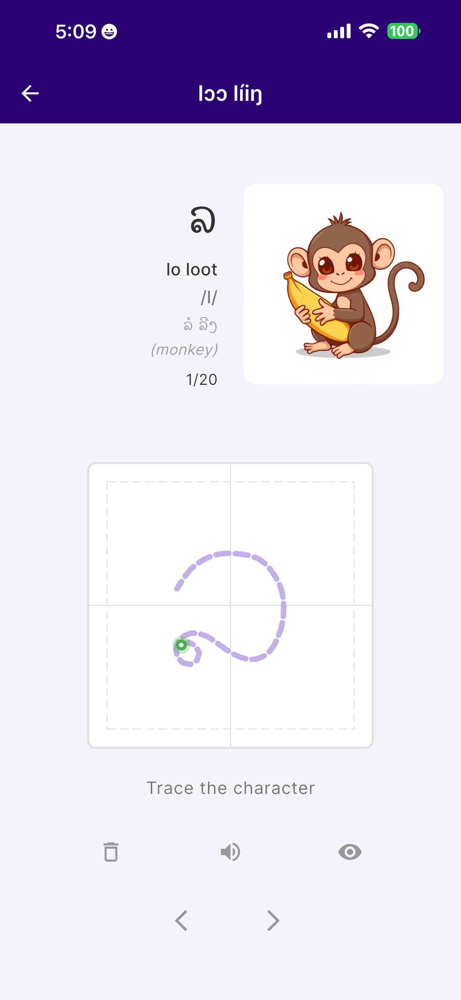

# Write Lao — marketing site

A single-page, mobile-first landing page for the Write Lao app. Zero build
step — pure HTML, CSS, and vanilla JS. Serve the `website/` directory from
anywhere (Netlify, GitHub Pages, Vercel, an S3 bucket, or `python -m
http.server`).

## Files

| File | Purpose |
|---|---|
| `index.html` | Page markup. Mobile-first, semantic, accessible. |
| `styles.css` | Styles. CSS variables at the top for easy theming. |
| `script.js` | Header shadow on scroll, video modal, footer year. |
| `assets/favicon.svg` | Tab icon — saffron tile with the Lao letter ຂ. |
| `assets/og-image.png` | **Placeholder** — drop in a 1200×630 social share image. |

## Local preview

```sh
cd website
python3 -m http.server 8000
# then open http://localhost:8000
```

## What to replace before launch

Each item is marked with a comment or the literal word "PLACEHOLDER" in the
source so you can grep for them.

### 1. The demo video

Open `script.js` and replace:

```js
const YOUTUBE_ID = "REPLACE_WITH_YOUTUBE_VIDEO_ID";
```

with the real YouTube video ID (the 11-character string from the URL — e.g.
from `https://youtu.be/abc123XYZ_0` the ID is `abc123XYZ_0`). The iframe is
loaded lazily on click via `youtube-nocookie.com`, so nothing loads for
users who don't open the modal.

Optionally: replace the gradient placeholder thumbnail inside `.demo-thumb`
with an `` — use a real frame from
the video for best conversion.

### 2. The hero screenshot

In `index.html`, find the `.hero-visual` block and replace the
`<div class="phone-screen placeholder-tint">…</div>` with an ``:

```html
<div class="phone-screen">
  
</div>
```

### 3. The screenshot reel

The `.shot-reel` contains five `.phone` placeholders. For each, swap the
`.placeholder-tint` div for an `` the same way. Suggested filenames
(match the existing captions):

- `assets/shot-01-alphabet.png` — alphabet lessons list
- `assets/shot-02-writing.png` — writing canvas mid-stroke
- `assets/shot-03-vocab-intro.png` — vocab intro card
- `assets/shot-04-srs.png` — spaced-review card
- `assets/shot-05-progress.png` — progress tracker

Export at **1170×2532** (iPhone Pro resolution) or any 9:19.5 ratio. The
`.phone` frame will scale anything to fit.

### 4. Download links

In `index.html` find `<section class="download">`. Each `<a class="dl-btn"
href="#">` needs its real URL:

| `data-platform` | Example destination |
|---|---|
| `ios` | `https://apps.apple.com/app/id…` |
| `android` | `https://play.google.com/store/apps/details?id=…` |
| `mac` | Direct `.dmg` link or Mac App Store URL |
| `windows` | Direct `.msix` or `.exe` link, or Microsoft Store URL |
| `linux` | `.AppImage` / `.deb` / `.rpm` URL or a release page |

### 5. Testimonials

The `.social-proof` section has two placeholder blockquotes and a
"ratings · coming soon" row. Replace with real quotes once the app ships.
Keep them specific (what was hard, what clicked, after how long).

### 6. Meta / social share

In `<head>`:

- Replace `assets/og-image.png` (currently missing) with a real 1200×630
  social share card.
- Update the canonical URL if you serve from a subpath.

### 7. Legal pages

Footer links to `Privacy` and `Terms` are `href="#"` stubs. Point them at
your real policy pages before launch.

---

## Image generator prompts

These are written for Midjourney / DALL·E / Stable Diffusion. Tune as
needed. Each one targets a specific slot on the page.

### Hero screenshot context image (if you want a lifestyle shot instead of an in-app screenshot)

> A close-up of a hand holding a stylus, drawing a flowing Lao script
> character mid-stroke on a tablet screen. Minimalist, warm cream
> background with soft saffron and golden light washing in from the
> right. Editorial photography, shallow depth of field, natural window
> light, slight film grain, 35mm lens. The character being drawn is
> clearly in progress — one stroke completed in dark ink, the next stroke
> starting in a lighter ghosted color. Mood: calm, focused, reverent.
> Aspect ratio 9:16.

### OG / social share image (1200×630)

> Hero promotional graphic for a language-learning app called "Write
> Lao". Large, beautifully drawn Lao script character "ຂ" taking up the
> left third, rendered in a deep saffron-terracotta ink with a subtle
> brush texture. To the right, the words "Write Lao — master Lao, one
> stroke at a time" in elegant serif typography. Warm cream background
> (#faf6ef). Soft golden light glow behind the character. App icon
> (saffron tile with ຂ) small in the bottom-right corner. Clean,
> editorial, high-end publication aesthetic. Aspect ratio 1200:630.

### Feature section background (subtle, decorative — optional)

> An abstract pattern of Lao script strokes — gentle curves, circles,
> and hooks — arranged in a loose, airy composition on a warm cream
> background. Soft saffron accents, very low contrast, minimalist.
> Could serve as a near-invisible background texture. Aspect ratio 16:9.

### Video thumbnail (if you don't use a frame from the video itself)

> Split-composition YouTube thumbnail for a 2-minute app demo video.
> Left half: a hand drawing a Lao character on a phone screen, dynamic
> angle. Right half: a warm gradient (saffron to deep teal) with bold
> white text reading "Learn to Write Lao in 2 minutes". Large white play
> triangle centered on the gradient side. Shot in the style of a
> high-end tech product video. Aspect ratio 16:9.

### App Store feature screenshot captions (if you need illustrated tiles)

Each of these would pair a phone mockup with a short marketing caption
on a warm cream background:

> A warm cream background with a phone mockup showing the Write Lao
> writing canvas mid-stroke. To the right of the phone, bold serif text
> reads "Every stroke guided." Beneath, a subtle caption: "All 58 Lao
> characters. Ordered strokes. Live direction hints." Saffron accents.
> Minimalist composition, editorial tech-product style. 9:16.

Repeat for each feature: "500 essential words", "Spaced repetition",
"Native audio", "Works offline", swapping the phone content and caption
each time.

---

## Accessibility notes

- Skip-to-content link for keyboard users.
- Modal has `role="dialog"`, `aria-modal`, returns focus to the opener on
  close, and supports ESC to close.
- All interactive elements are reachable via keyboard.
- Respects `prefers-reduced-motion`.
- Color contrast meets WCAG AA for all body text; run a real audit before
  launch once you've dropped in real imagery.

## Browser support

Uses modern CSS (logical properties, `aspect-ratio`, `clamp()`, `gap` in
flexbox). Tested mentally against Safari 15+, Chrome 100+, Firefox 100+.
No polyfills needed for evergreen browsers.
